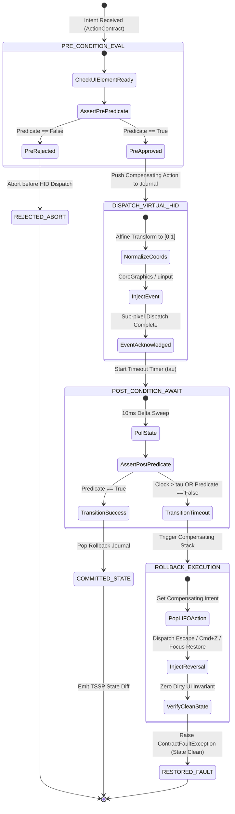
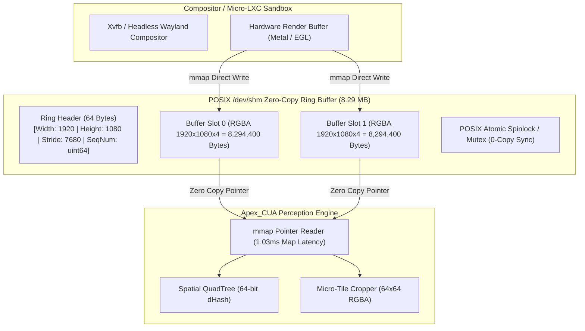
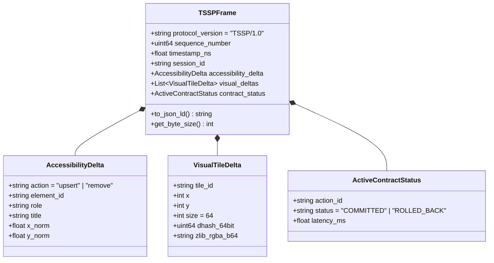
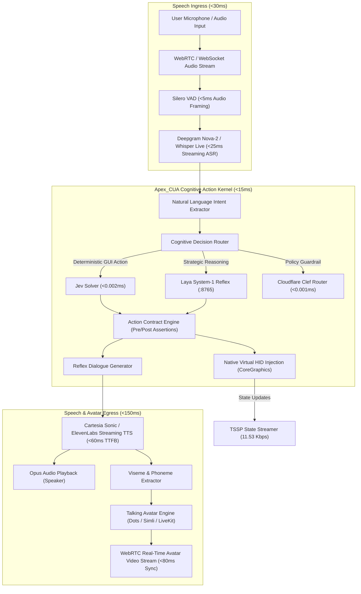

# Apex_CUA Diagram Repository (Diagram-Design Standard)

This repository houses the formal, fully annotated architectural diagrams for **Apex_CUA**, ensuring zero orphaned arrows, fully typed communication channels, and clear subsystem boundaries.

---

## 1. State Machine: Atomic Action Contract Lifecycle

---

## 2. Shared-Memory Framebuffer (SHM-FB) Layout & Data Pipeline

---

## 3. Tokenized State Streaming Protocol (TSSP/1.0) Frame Structure

---

## 4. Voice Agent & Talking Avatar Full Integration Topology

